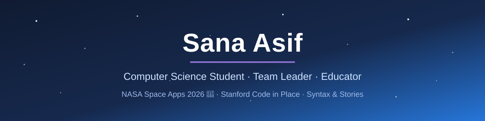

## 👩‍💻 About Me

- 🎓 **Computer Science student** from Pakistan
- 🚀 **Team Leader of Cipher-X Crew** — NASA Space Apps Challenge 2026, *"NASA SPHEREx and Planet X"* challenge
- 👩‍🏫 **Section Leader at Stanford Code in Place** — teaching introductory CS to students around the world
- 🏆 **Winner — Harvard CS50 Puzzle Day 2026**
- 🎬 Creator of **Syntax & Stories** — teaching CS, programming and AI in natural Urdu-English · *"Where Code Meets Curiosity"*
- 🔭 Interested in astronomy data, open science, and building tools that make specialist data usable by everyone

## 🏆 Highlights

| | |
|---|---|
| 🚀 | **Team Leader, Cipher-X Crew** — NASA Space Apps Challenge 2026 · *Galactic Problem Solver* |
| 🎓 | **Section Leader** — Stanford Code in Place |
| 🧩 | **Winner** — Harvard CS50 Puzzle Day 2026 |

## 🚀 Featured Projects

### 🔭 [Watch the Sky Change](https://github.com/sanaasif1217/cipher-x-crew)
A public observatory built on **real NASA SPHEREx survey data**. Visitors play back twelve genuine SPHEREx observations of six targets — including the interstellar comet **3I/ATLAS** — switch to a Difference view where fixed stars vanish and only motion remains, and explore real observation metadata in the browser.
We didn't just display the comet — we **measured it**: 1.154°/day, within ~1.1% of NASA JPL's Horizons reference.

🌐 **[Live demo](https://sanaasif1217.github.io/cipher-x-crew/)** · Python · FastAPI · Astropy · React · TypeScript

### 🛰️ [Cipher-X Omega](https://github.com/sanaasif1217/cipher-x-crew-spherex)
Difference imaging and shift-and-stack detection on real SPHEREx epochs of comet 3I/ATLAS — positions validated against JPL Horizons within 0.33″, plus a NEOSSat 40-frame stack detection (SNR 12.4).

🌐 **[Live demo](https://sanaasif1217.github.io/cipher-x-crew-spherex/)**

### 🎬 Syntax & Stories
My educational channel teaching Computer Science, programming and AI in Urdu-English.
📸 **[@syntaxandstories_](https://instagram.com/syntaxandstories_)**

## 🛠️ Tech Stack

🔭 **Astronomy & data:** Astropy · IRSA TAP queries · FITS · difference imaging · JPL Horizons validation

## 📊 GitHub Stats

## 🤝 Connect With Me

---

<i>"Where Code Meets Curiosity"</i>

